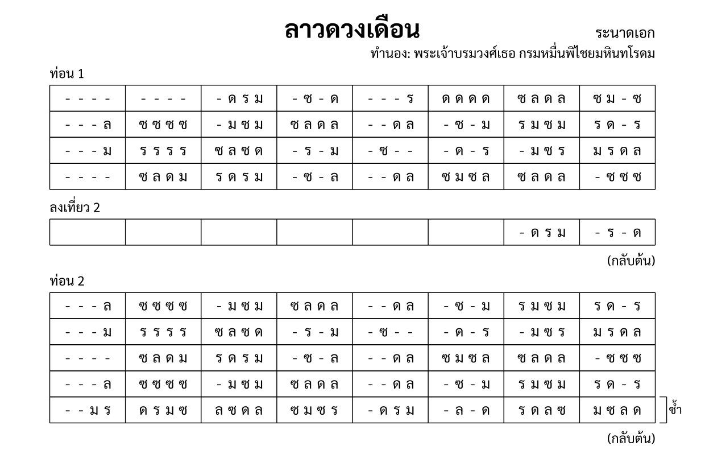

import ExampleXml from "@/components/ExampleXml.astro";

[โครงสร้างไฟล์](/th/tutorial/2-file_structure/) แสดงท่อนเดียวที่ซ้ำ หน้านี้เพิ่มท่อนหลายท่อน การซ้อนซ้ำ การซ้ำบรรทัด และเที่ยวจบแบบที่สอง ทั้งหมดนี้มีอยู่จริงในเพลงลาวดวงเดือน



## หลายท่อน

โน้ตเพลงหนึ่งมีได้หลายท่อน ลำดับมาจากตำแหน่งใน `<structure>` ไม่ได้มาจากแอตทริบิวต์ใด:

```xml
<structure>
  <section id="s1" name="ท่อน 1" />
  <section id="s2" name="ท่อน 2" />
  <section id="s3" name="ท่อน 3" />
</structure>
```

ท่อน 1 เล่นก่อน ตามด้วยท่อน 2 แล้วท่อน 3 การเปลี่ยน `id` หรือย้ายตำแหน่งของ `<section>` ก็เปลี่ยนลำดับนี้ ส่วน `<section-ref>` ของแต่ละท่อนใน `<part-data>` โยงกลับมาหาท่อนด้วย `id`

## เล่นซ้ำทั้งท่อน

`<repeat>` คลุมท่อนไว้เพื่อให้เล่นท่อนนั้นมากกว่าหนึ่งครั้ง ในไฟล์ลาวดวงเดือนมีการซ้ำทุกท่อน:

```xml
<repeat times="2">
  <annotation>ท่อน 1</annotation>
  <section id="s1" name="ท่อน 1" />
  <annotation>
    <text align="right">(กลับต้น)</text>
  </annotation>
</repeat>
```

ท่อน 1 เล่นสองครั้ง หมายเหตุ "(กลับต้น)" บอกผู้เล่นให้ย้อนกลับไปต้นท่อน การซ้ำซ้อนกันได้ และ `<repeat>` ที่ซ้อนกันจะคูณจำนวนรอบเข้าด้วยกัน

## หมายเลขบรรทัดและห้องเริ่มนับใหม่

หมายเลขบรรทัดและหมายเลขห้องนับกันภายในองค์ประกอบแม่ของตัวเอง เมื่อท่อนซ้ำ รอบที่สองก็เริ่มนับใหม่จากบรรทัด 1 ห้อง 1 ตัวเลขไม่สะสมข้ามรอบ

```xml
<!-- รอบแรก: บรรทัด 1 ห้อง 1 ถึง 8 -->
<!-- รอบที่สอง: บรรทัด 1 ห้อง 1 ถึง 8 อีกครั้ง -->
```

แบบนี้ทำให้อ้างถึงกันได้ง่าย "บรรทัด 2 ห้อง 5" หมายถึงที่เดียวกันทุกรอบที่ท่อนนั้นเล่น

## การซ้ำบรรทัด

`<line-repeat>` ซ้ำบรรทัดเดียวหรือหลายบรรทัดภายในท่อนได้ โดยไม่ต้องเขียนบรรทัดนั้นซ้ำอีก:

```xml
<section id="s2" name="ท่อน 2">
  <line-repeat first="5" last="5" times="2"/>
</section>
```

ตรงนี้ซ้ำบรรทัด 5 ของท่อน 2 สองครั้ง แอตทริบิวต์ `first` กับ `last` กำหนดช่วงบรรทัด ถ้าค่าเท่ากันก็ซ้ำบรรทัดเดียว ถ้าต่างกันก็ซ้ำทั้งช่วง

จากลาวดวงเดือน ท่อน 3 ใช้ช่วง:

```xml
<section id="s3" name="ท่อน 3">
  <line-repeat first="1" last="2" times="2"/>
  <line-repeat first="4" last="4" times="2"/>
</section>
```

บรรทัด 1 ถึง 2 ซ้ำสองครั้ง แล้วบรรทัด 4 ซ้ำอีกสองครั้ง `<line-repeat>` เป็นลูกของ `<section>` ไม่ใช่ของ `<structure>`

## เที่ยวจบ

บางครั้งบรรทัดสุดท้ายของท่อนในรอบสุดท้ายก็ไม่เหมือนรอบก่อนหน้า `<ending pass="2">` ให้บรรทัดอีกแบบหนึ่งที่ใช้เฉพาะรอบที่ระบุไว้:

```xml
<ending pass="2">
  <annotation>ลงเที่ยว 2</annotation>
  <line number="4">
    <measure number="1"></measure>
    <measure number="2"></measure>
    <measure number="3"></measure>
    <measure number="4"></measure>
    <measure number="5"></measure>
    <measure number="6"></measure>
    <measure number="7"><rest/><note pitch="ด"/><note pitch="ร"/><note pitch="ม"/></measure>
    <measure number="8"><rest/><note pitch="ร"/><rest/><note pitch="ด"/></measure>
  </line>
</ending>
```

`<ending>` เข้าไปแทนที่บรรทัดที่ตรงกันในรอบที่ระบุไว้ รอบแรกเล่นบรรทัด 4 เดิมตามที่เขียน ส่วนรอบที่สอง ห้อง 1 ถึง 6 ว่าง คือพาร์ตนี้หยุด แล้วห้อง 7 ถึง 8 จึงเล่นประโยคปิดท้าย หมายเหตุ "ลงเที่ยว 2" เป็นเครื่องหมายบอกผู้เล่นว่าตรงนี้คือเที่ยวจบ

`<ending>` เป็นลูกของ `<section-ref>` ไม่ใช่ของ `<section>` แต่ละพาร์ตจึงมีเที่ยวจบของตัวเองสำหรับท่อนเดียวกันได้

## ไฟล์ตัวอย่าง

ไฟล์นี้มีท่อน 1 ครบทั้งสี่บรรทัด และท่อน 2 ห้าบรรทัดพร้อมการซ้ำบรรทัดที่ 5 ท่อน 1 มี `<ending pass="2">` อยู่ที่บรรทัด 4 และทั้งสองท่อนถูกคลุมไว้ด้วย `<repeat times="2">`

<ExampleXml file="tutorial6-sections-repeats.txml" />

---

ขั้นต่อไป ดู [วงดนตรีและเครื่องดนตรีที่ซ้อนแถว](/th/tutorial/7-ensembles_stacked/) สำหรับโน้ตเพลงที่มีหลายพาร์ต และเครื่องดนตรีที่เขียนโน้ตข้ามหลายแถว

:::note[องค์ประกอบที่แนะนำ]
[`<section>`](/th/reference/elements/section/), [`<repeat>`](/th/reference/elements/repeat/), [`<line-repeat>`](/th/reference/elements/line-repeat/), [`<ending>`](/th/reference/elements/ending/)
:::

[ลองเล่นใน Playground](/th/playground/)
