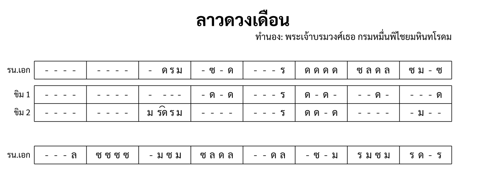

import ExampleXml from "@/components/ExampleXml.astro";

หน้าก่อน ๆ ใช้เครื่องดนตรีหนึ่งหรือสองชิ้น หน้านี้เพิ่มพาร์ตหลายพาร์ต เครื่องดนตรีที่ซ้อนแถว และพาร์ตที่ข้ามบางท่อนไป



## Ensemble และ part-data

เครื่องดนตรีทุกชิ้นที่ระบุไว้ใน `<ensemble>` มี `<part-data>` ของตัวเอง โดยมีแอตทริบิวต์ `part` เป็นตัวโยงทั้งสองเข้าหากัน:

```xml
<ensemble>
  <part id="P1">
    <instrument-name>ระนาดเอก</instrument-name>
    <instrument-short-name>รน.เอก</instrument-short-name>
  </part>
  <part id="P2" stack="khim" row="1">
    <instrument-name>ขิม 1</instrument-name>
  </part>
</ensemble>
```

`<part-data>` แต่ละตัวเก็บข้อมูลดนตรีของเครื่องดนตรีชิ้นนั้น พาร์ตแต่ละตัวจะอ้างถึงคนละท่อน เล่นคนละบรรทัด และมีข้อมูลดนตรีไม่เท่ากันก็ได้ ขอเพียงห้องที่ตรงกันมีจำนวนจังหวะเท่ากัน

## เครื่องดนตรีที่เขียนหลายแถว

เครื่องดนตรีบางชิ้นเขียนโน้ตข้ามหลายแถว แอตทริบิวต์ `stack` กับ `row` เป็นตัวรวมพาร์ตเหล่านั้นให้เป็นเครื่องดนตรีชิ้นเดียว:

```xml
<part id="P2" stack="khim" row="1">
  <instrument-name>ขิม 1</instrument-name>
</part>
<part id="P3" stack="khim" row="2">
  <instrument-name>ขิม 2</instrument-name>
</part>
```

พาร์ตที่ใช้ค่า `stack` เดียวกันจะถูกวาดเป็นแถวที่ติดกันของเครื่องดนตรีชิ้นเดียว และใช้ป้ายชื่อร่วมกัน ส่วน `row` เป็นตัวกำหนดลำดับ คือแถว 1 อยู่บน แถว 2 อยู่ล่าง

ในกรณีของขิม แถวหมายถึงช่วงเสียง คือสูง กลาง ต่ำ ไม่ใช่มือซ้ายมือขวา ความสัมพันธ์ทางดนตรีระหว่างแถวเป็นเรื่องที่ผู้เรียบเรียงกำหนดเอง รูปแบบเพียงบันทึกไว้ว่าแถวไหนอยู่ด้วยกันเท่านั้น

## ชื่อย่อของเครื่องดนตรี

`<instrument-short-name>` ให้ชื่อย่อไว้ใช้กับโน้ตเพลงที่มีพื้นที่จำกัด เมื่อชื่อเต็มทำให้หน้าแน่นเกินไป ตัวแสดงผลจะหยิบชื่อย่อมาใช้แทน:

```xml
<part id="P1">
  <instrument-name>ระนาดเอก</instrument-name>
  <instrument-short-name>รน.เอก</instrument-short-name>
</part>
```

ชื่อย่อจะมีหรือไม่มีก็ได้ ถ้าไม่มี ตัวแสดงผลก็ใช้ `<instrument-name>` ทุกที่

## เครื่องดนตรีที่ไม่เล่นบางท่อน

พาร์ตหนึ่งไม่จำเป็นต้องเล่นทุกท่อน ถ้า `<part-data>` ไม่มี `<section-ref>` ของท่อนไหน พาร์ตนั้นก็หยุดตลอดท่อนนั้น:

```xml
<part-data part="P2">
  <section-ref section="s1">
    <!-- ขิมเล่นในท่อน 1 -->
  </section-ref>
  <!-- ไม่มี section-ref สำหรับ s2: ขิมหยุดท่อน 2 -->
</part-data>
```

พาร์ตนั้นยังอยู่ใน `<ensemble>` และยังมีแถวของตัวเองในโน้ตเพลงที่แสดงผลออกมา เพียงแต่แถวนั้นจะว่างตลอดท่อนนี้

## ข้อตกลงเรื่องจำนวนจังหวะ

ทุกพาร์ตที่อ้างถึงท่อนเดียวกันต้องมีจำนวนจังหวะต่อห้องตรงกัน ถ้าบรรทัด 1 ห้อง 1 ของระนาดเอกมีโน้ตสี่ตัว ขิม 1 ก็ต้องมีสี่จังหวะที่บรรทัด 1 ห้อง 1 เหมือนกัน จะเป็นโน้ต ตัวหยุด หรือกลุ่มก็ได้

ข้อยกเว้นคือพาร์ตข้อความทั้งสองชนิด ห้องของพาร์ตเนื้อร้องเก็บพยางค์ไม่ใช่จังหวะ จำนวนรายการจึงเป็นตัวตัดสินว่าคำไปอยู่ตรงไหนในช่อง ส่วนสัญลักษณ์ของพาร์ตคอร์ดชิดขวาไปทางท้ายห้อง ดู [เนื้อร้องและคอร์ด](/th/tutorial/8-lyrics/)

## ไฟล์ตัวอย่าง

ไฟล์นี้มีสามพาร์ต คือระนาดเอก ขิม 1 (stack="khim" row="1") และขิม 2 (stack="khim" row="2") ท่อน 1 มีครบทั้งสามพาร์ต ส่วนท่อน 2 มีแต่ระนาดเอก เพราะขิมทั้งสองไม่มี `<section-ref>` ของท่อน 2 จึงหยุดไป

<ExampleXml file="tutorial7-ensemble.txml" />

---

ขั้นต่อไป ดู [เนื้อร้องและคอร์ด](/th/tutorial/8-lyrics/) สำหรับพาร์ตขับร้อง พยางค์ กฎการนับ และสัญลักษณ์คอร์ด

:::note[องค์ประกอบที่แนะนำ]
[แอตทริบิวต์ `stack`](/th/reference/elements/part/#แอตทริบิวต์), [แอตทริบิวต์ `row`](/th/reference/elements/part/#แอตทริบิวต์), [`<instrument-short-name>`](/th/reference/elements/instrument-short-name/)
:::

[ลองเล่นใน Playground](/th/playground/)
