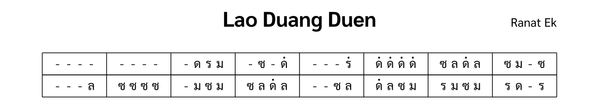

import ExampleXml from "@/components/ExampleXml.astro";

ตัวอย่างนี้เป็นโน้ตเพลงง่าย ๆ สำหรับเครื่องดนตรีชิ้นเดียว คือระนาดเอกบรรเลงสองบรรทัดแรกของเพลงลาวดวงเดือน



## ตัวอย่าง XML

<ExampleXml file="tutorial1-hello-world.txml" />

## คำอธิบาย

ต่อไปนี้คือคำอธิบายแต่ละองค์ประกอบ

```xml
<?xml version="1.0" encoding="UTF-8"?>
```

บรรทัดนี้คือการประกาศ XML บอกว่าเอกสารนี้เป็น XML และเข้ารหัสแบบ UTF-8

```xml
<thai-score xmlns="https://thaimusicxml.anan.ovh/ns/1" version="1.0">
```

`<thai-score>` คือรากของเอกสาร ThaiMusicXML แอตทริบิวต์ `xmlns` ประกาศเนมสเปซของ ThaiMusicXML ซึ่งเป็นสิ่งที่เครื่องมือใช้แยกองค์ประกอบเหล่านี้จากคำศัพท์ XML อื่น และใช้ตัดสินว่าจะอ่านไฟล์นี้ได้หรือไม่ ส่วน `version` บันทึกว่าไฟล์อ้างอิงสเปกรุ่นใด

```xml
<header>
  <title>Lao Duang Duen</title>
</header>
```

`<header>` เก็บข้อมูลเมตาของโน้ตเพลง ต้องมี `<title>` ซึ่งในตัวอย่างนี้คือชื่อเพลง และจะมี `<composer>` กับ `<tuning>` เพิ่มมาด้วยก็ได้

```xml
<structure>
  <section id="s1" name="ท่อน 1" />
</structure>
```

`<structure>` กำหนดโครงสร้างของโน้ตเพลง `<section>` แต่ละตัวมี `id` ไว้ให้ `<section-ref>` อ้างถึงภายหลังเพื่อแนบข้อมูลดนตรีเข้ามา และจะมี `name` เป็นป้ายให้ผู้อ่านด้วยก็ได้ ลำดับของท่อนในโน้ตเพลงคือลำดับที่ `<section>` แต่ละตัวปรากฏใน `<structure>`

```xml
<ensemble>
  <part id="P1">
    <instrument-name>Ranat Ek</instrument-name>
  </part>
</ensemble>
```

`<ensemble>` แสดงรายชื่อเครื่องดนตรีทั้งหมด `<part>` แต่ละตัวมี `id` ที่ไม่ซ้ำกันและ `<instrument-name>` ตัวอย่างนี้มีระนาดเอกเพียงเครื่องเดียว

```xml
<part-data part="P1">
  <section-ref section="s1">
    <line number="1">
      <measure number="1">
        <rest/><rest/><rest/><rest/>
      </measure>
      <measure number="2">
        <rest/><rest/><rest/><rest/>
      </measure>
      <measure number="3">
        <rest/><note pitch="ด"/><note pitch="ร"/><note pitch="ม"/>
      </measure>
      ...
    </line>
  </section-ref>
</part-data>
```

`<part-data>` บรรจุข้อมูลดนตรีของพาร์ตหนึ่ง แอตทริบิวต์ `part` บอกว่าเป็นพาร์ตไหนใน `<ensemble>` ส่วน `<section-ref>` ที่อยู่ข้างในโยงไปหาท่อนใน `<structure>` ดนตรีจัดเรียงเป็นองค์ประกอบ `<line>` และแต่ละบรรทัดมี `<measure>` พร้อมแอตทริบิวต์ `number`

โน้ตใช้ชื่อระดับเสียงของไทยในแอตทริบิวต์ `pitch` แต่ละเสียงสะกดได้สามแบบและใช้แทนกันได้ `pitch="1"`, `pitch="D"`, และ `pitch="ด"` จึงหมายถึงโน้ตตัวเดียวกัน เพลงนี้ใช้ห้าเสียงจากทั้งหมดเจ็ดเสียง:

| ตัวเลข | ไทย | โรมัน | ซอลเฟจ |
| ------ | ---- | --------- | ------- |
| 1      | ด    | D         | Do      |
| 2      | ร    | R         | Re      |
| 3      | ม    | M         | Mi      |
| 4      | ฟ    | F         | Fa      |
| 5      | ซ    | S         | Sol     |
| 6      | ล    | L         | La      |
| 7      | ท    | T         | Ti      |

คอลัมน์ซอลเฟจมีไว้ช่วยออกเสียงตารางเท่านั้น ค่า `pitch` ที่ใช้ได้จริงคือสามคอลัมน์ทางซ้าย

เติม ํ (นิคหิต) ต่อท้ายชื่อโน้ตเพื่อยกขึ้นหนึ่ง octave เติม ฺ (พินทุ) เพื่อลดลงหนึ่ง octave เช่น `ดํ` คือ ด ที่สูงขึ้นหนึ่ง octave และ `ทฺ` คือ ท ที่ต่ำลงหนึ่ง octave เครื่องหมายกำกับใช้ได้กับการสะกดทั้งสามแบบ รายละเอียดทั้งหมดอยู่ในหน้า [โน้ต ตัวหยุด และ octave](/th/v1_0/tutorial/4-notes_and_octaves/)

```xml
<rest/>
```

ตัวหยุดเป็นองค์ประกอบปิดตัวเองที่ไม่มีแอตทริบิวต์ กินเวลาหนึ่งจังหวะเท่ากับโน้ตหนึ่งตัว และหมายความว่าเครื่องดนตรีไม่ได้ตีเสียงใหม่ในจังหวะนั้น โน้ตไทยไม่มีการลากเสียงที่เขียนกำกับไว้ เสียงที่ยังก้องอยู่ใต้ตัวหยุดถัดมาจึงเป็นเรื่องปกติของตัวเครื่องดนตรีเอง ไม่ใช่สิ่งที่โน้ตต้องบันทึก

ไฟล์นี้เป็นไฟล์ ThaiMusicXML ที่สมบูรณ์แล้ว ขั้นต่อไป ดู [โครงสร้างไฟล์](/th/v1_0/tutorial/2-file_structure/) สำหรับวิธีเพิ่มเครื่องดนตรีหลายชิ้น ท่อน และคำกำกับการบรรเลง

:::note[องค์ประกอบที่แนะนำ]
[`<thai-score>`](/th/v1_0/reference/elements/thai-score/), [`<header>`](/th/v1_0/reference/elements/header/), [`<title>`](/th/v1_0/reference/elements/title/), [`<structure>`](/th/v1_0/reference/elements/structure/), [`<section>`](/th/v1_0/reference/elements/section/), [`<ensemble>`](/th/v1_0/reference/elements/ensemble/), [`<part>`](/th/v1_0/reference/elements/part/), [`<part-data>`](/th/v1_0/reference/elements/part-data/), [`<section-ref>`](/th/v1_0/reference/elements/section-ref/), [`<line>`](/th/v1_0/reference/elements/line/), [`<measure>`](/th/v1_0/reference/elements/measure/), [`<note>`](/th/v1_0/reference/elements/note/), [`<rest>`](/th/v1_0/reference/elements/rest/)
:::

[ลองเล่นใน Playground](/th/playground/)
