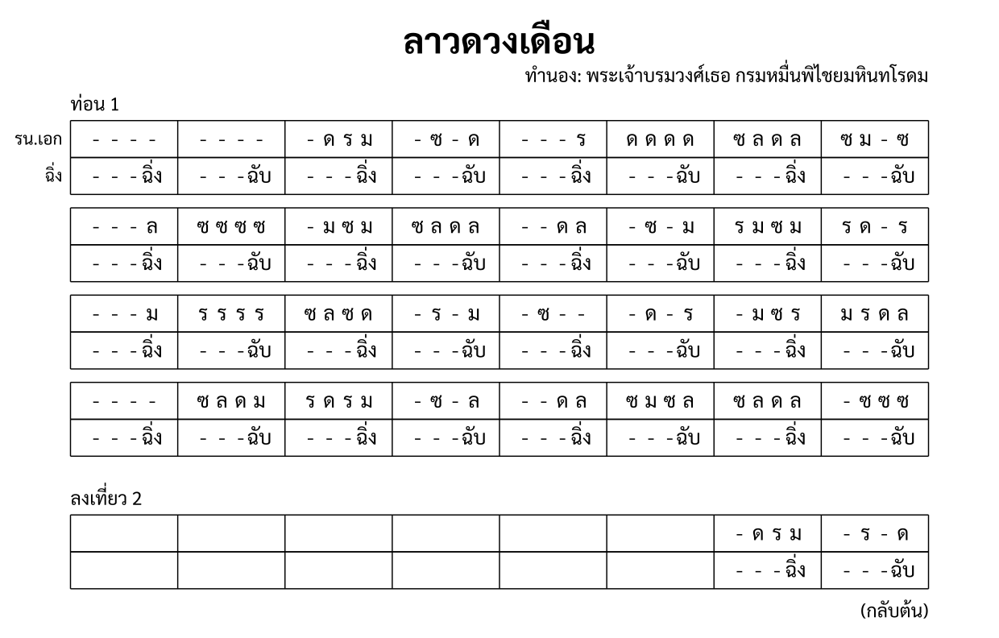

import ExampleXml from "@/components/ExampleXml.astro";

ตัวอย่าง [Hello World](/th/v1_0/tutorial/1-hello_world/) ใช้เครื่องดนตรีชิ้นเดียวและท่อนเดียว หน้านี้เพิ่มเครื่องดนตรีชิ้นที่สอง คำกำกับการบรรเลง หมายเหตุประกอบ และการซ้ำ โดยยกเพลงลาวดวงเดือนของจริงมาใช้



## ตัวอย่าง XML

<ExampleXml file="tutorial2-file-structure.txml" />

## ส่วนหัว

`<header>` มี `<composer>` อยู่ข้าง ๆ `<title>` ได้:

```xml
<header>
  <title>ลาวดวงเดือน</title>
  <composer><text align="right">ทำนอง: พระเจ้าบรมวงศ์เธอ กรมหมื่นพิไชยมหินทโรดม</text></composer>
</header>
```

`<composer>` เขียนเป็นข้อความธรรมดาก็ได้ หรือจะใส่ `<text>` เป็นลูกพร้อมแอตทริบิวต์ `align` ก็ได้ เช่นเดียวกับ `<annotation>` ในที่นี้บรรทัดผู้แต่งจัดชิดขวา

## โครงสร้าง

`<structure>` บรรจุโครงสร้างของโน้ตเพลง ข้างในมีได้ทั้งหมายเหตุประกอบ คำกำกับการบรรเลง ท่อน และการซ้ำ:

```xml
<structure>
  <direction>
    <nathap value="ลาว" />
    <chan value="2" />
    <bpm>60</bpm>
  </direction>
  <repeat times="2">
    <annotation>ท่อน 1</annotation>
    <section id="s1" name="ท่อน 1" />
    <annotation>
      <text align="right">(กลับต้น)</text>
    </annotation>
  </repeat>
</structure>
```

- **`<direction>`**: คำกำกับการบรรเลงที่มีผลกับโน้ตเพลงทั้งฉบับ
  - `<nathap>` ระบุชื่อหน้าทับ ในที่นี้คือหน้าทับลาว
  - `<chan>` กำหนดชั้น `value="2"` คือสองชั้น ชั้นไม่ใช่ความเร็ว แต่เป็นระยะห่างของรอบฉิ่ง ดู [แบบจำลองโน้ตเพลง](/th/v1_0/tutorial/3-the_score_model/) สำหรับข้อแตกต่าง
  - `<bpm>` กำหนดความเร็วไว้ที่ 60 จังหวะต่อนาที
- **`<repeat times="2">`**: คลุมท่อนด้วย `<repeat>` เพื่อเล่นมากกว่าหนึ่งครั้ง ในที่นี้ท่อน 1 เล่นสองครั้ง
- **`<annotation>`**: ข้อความอิสระ ใน `<structure>` หมายเหตุประกอบใช้ตั้งชื่อท่อนและใส่บันทึกสำหรับการบรรเลง `<text align="right">(กลับต้น)</text>` บอกผู้เล่นให้ย้อนกลับไปต้นท่อน

## การนับบรรทัดและห้อง

หมายเลขบรรทัดและหมายเลขห้องนับกันภายในองค์ประกอบแม่ของตัวเอง บรรทัดเริ่มนับจาก `1` ใหม่ในทุก `<section-ref>` ส่วนห้องเริ่มนับจาก `1` ใหม่ในทุก `<line>`:

```xml
<section-ref section="s1">
  <line number="1">
    <measure number="1">...</measure>
    <measure number="2">...</measure>
  </line>
  <line number="2">
    <measure number="1">...</measure>
  </line>
</section-ref>
```

ลำดับของท่อนคือตำแหน่งของ `<section>` แต่ละตัวเมื่อเทียบกับตัวอื่นใน `<structure>` ไม่ได้มาจากแอตทริบิวต์ใด การซ้ำท่อนก็ไม่เปลี่ยนหมายเลขบรรทัดหรือหมายเลขห้อง รอบที่สองเริ่มนับใหม่จากบรรทัด 1 ห้อง 1 เหมือนเดิม ดู [ท่อน การซ้ำ และเที่ยวจบ](/th/v1_0/tutorial/6-sections_repeats_endings/) สำหรับการซ้อนซ้ำและ `<line-repeat>`

## เครื่องดนตรีหลายชิ้น

`<ensemble>` มีได้หลายพาร์ต:

```xml
<ensemble>
  <part id="P1">
    <instrument-name>ระนาดเอก</instrument-name>
    <instrument-short-name>รน.เอก</instrument-short-name>
  </part>
  <part id="P2" type="unpitched">
    <instrument-name>ฉิ่ง</instrument-name>
  </part>
</ensemble>
```

P1 คือระนาดเอก ส่วน `<instrument-short-name>` ให้ชื่อย่อไว้ใช้กับโน้ตเพลงที่มีพื้นที่จำกัด

P2 คือฉิ่ง การเพิ่ม `type="unpitched"` หมายความว่าโน้ตของพาร์ตนี้ใช้ `sound` แทน `pitch`:

```xml
<rest/><rest/><rest/><note sound="ฉิ่ง"/>
```

`sound="ฉิ่ง"` คือเสียงเปิด ส่วน `sound="ฉับ"` คือเสียงปิด เพลงนี้เป็นสองชั้น ฉิ่งจึงตีห้องละครั้ง สลับฉิ่งกับฉับไปทีละห้อง ส่วนตัวหยุดสามตัวที่นำหน้าแต่ละครั้งเป็นตัวเติมอีกสามช่องที่เหลือ

## ข้อมูลพาร์ต

เครื่องดนตรีแต่ละชิ้นมี `<part-data>` ของตัวเอง แอตทริบิวต์ `part` โยงกลับไปหา `<part>` ใน `<ensemble>`:

```xml
<part-data part="P1">
  <section-ref section="s1">
    <line number="1">
      <measure number="1"><rest/><rest/><rest/><rest/></measure>
      <measure number="2"><rest/><rest/><rest/><rest/></measure>
      <measure number="3"><rest/><note pitch="ด"/><note pitch="ร"/><note pitch="ม"/></measure>
      <measure number="4"><rest/><note pitch="ซ"/><rest/><note pitch="ด"/></measure>
      ...
    </line>
  </section-ref>
</part-data>
```

`<part-data>` ทุกตัวมีโครงสร้างเหมือนกัน คือ `<section-ref>` โยงไปหาท่อน แล้วจึงมี `<line>` และ `<measure>` แต่ละห้องมีสี่ช่องพอดี เพราะเพลงนี้มีห้องละสี่จังหวะ จังหวะละหนึ่งช่อง

สองห้องแรกของบรรทัด 1 เป็นตัวหยุดทั้งหมด ระนาดเอกเข้ามาที่ห้อง 3 ตัวหยุดหมายถึงเครื่องดนตรีไม่ได้ตีเสียงใหม่ในจังหวะนั้น ไม่ได้หมายถึงความเงียบ

---

ขั้นต่อไป ดู [แบบจำลองโน้ตเพลง](/th/v1_0/tutorial/3-the_score_model/) สำหรับแนวคิดพื้นฐานที่ทำให้องค์ประกอบเหล่านี้ทำงานอย่างที่เป็น

:::note[องค์ประกอบที่แนะนำ]
[`<composer>`](/th/v1_0/reference/elements/composer/), [`<direction>`](/th/v1_0/reference/elements/direction/), [`<nathap>`](/th/v1_0/reference/elements/nathap/), [`<chan>`](/th/v1_0/reference/elements/chan/), [`<bpm>`](/th/v1_0/reference/elements/bpm/), [`<repeat>`](/th/v1_0/reference/elements/repeat/), [`<annotation>`](/th/v1_0/reference/elements/annotation/), [`<text>`](/th/v1_0/reference/elements/text/), [`<instrument-short-name>`](/th/v1_0/reference/elements/instrument-short-name/)
:::

[ลองเล่นใน Playground](/th/playground/)
