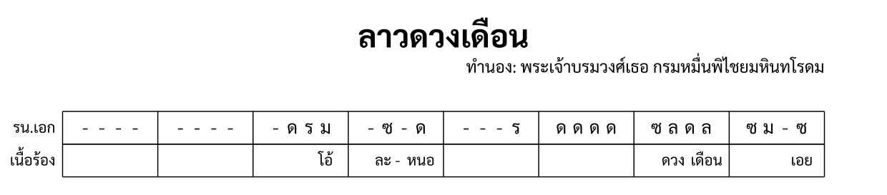

import ExampleXml from "@/components/ExampleXml.astro";

หน้านี้เพิ่มพาร์ตขับร้อง แล้วต่อด้วยแถวสัญลักษณ์คอร์ด ทั้งสองเขียนเป็น `<part>` เหมือนเครื่องดนตรี โดยมี `type="lyric"` หรือ `type="chord"` บอกว่าห้องบรรจุอะไร



## พาร์ตเนื้อร้อง

พาร์ตเนื้อร้องเป็นพาร์ตธรรมดาที่มีแถวของตัวเองในโน้ต ตั้ง `type="lyric"` บอกเรนเดอร์ให้คาดหวังพยางค์แทนโน้ต:

```xml
<part id="P2" type="lyric">
  <instrument-name>เนื้อร้อง</instrument-name>
</part>
```

`<part-data>` มีโครงสร้างเหมือนพาร์ตอื่น: `<section-ref>`, `<line>`, `<measure>` ต่างกันที่สิ่งที่อยู่ในห้อง

## พยางค์

`<syllable>` เก็บคำหรือพยางค์หนึ่งของข้อความไทย ภาษาไทยร้องทีละพยางค์ แต่ละพยางค์จึงมีองค์ประกอบของตัวเอง:

```xml
<measure number="4">
  <rest/><syllable>ละ -</syllable><rest/><syllable>หนอ</syllable>
</measure>
```

ยัติภังค์ท้ายพยางค์ (ละ -) แสดงว่าคำต่อเนื่องไปยังพยางค์ถัดไป ยัติภังค์เป็นส่วนของข้อความ ไม่ใช่ซินแทกซ์พิเศษ

## ตัวหยุดในห้องเนื้อร้อง

`<rest>` ในห้องเนื้อร้องหมายความว่าไม่มีการร้องในจังหวะนั้น ความหมายเหมือนตัวหยุดในพาร์ตเครื่องดนตรี คือไม่มีการเปล่งเสียงใหม่ ในการขับร้องไทยเรียกสิ่งนี้ว่าเอื้อน คือการประดับทำนองที่นักร้องถือโน้ตเดิมค้างไว้หรือหยุดเสียงชั่วครู่

## กฎการนับ

รายการในห้องเนื้อร้อง (พยางค์และตัวหยุด) กระจายตัวในห้องด้วยวิธีใดวิธีหนึ่งจากสองแบบ:

**ตรงจำนวนจังหวะ** ถ้าห้องมีสี่จังหวะและสี่รายการ แต่ละรายการใช้หนึ่งจังหวะ:

```xml
<measure number="1">
  <rest/><syllable>ดวง</syllable><rest/><syllable>เดือน</syllable>
</measure>
```

สี่รายการ สี่จังหวะ ดวง อยู่จังหวะ 2 เดือน อยู่จังหวะ 4

**น้อยกว่าจำนวนจังหวะ** ถ้าห้องมีสี่จังหวะแต่แค่สองรายการ รายการจะจัดกลางเซลล์:

```xml
<measure number="3">
  <syllable>หอม</syllable><syllable>กลิ่น</syllable>
</measure>
```

สองรายการในห้องสี่จังหวะ จัดกลาง นั่งประมาณจังหวะ 2 และ 3 ทั้งสองแบบเป็นวิธีเขียนพาร์ตขับร้องตามปกติ ผู้เรียบเรียงเลือกเอง

## คอร์ด

พาร์ตคอร์ดเป็นพาร์ตอีกชนิดที่บรรจุข้อความแทนดนตรี ประกาศด้วยวิธีเดียวกัน:

```xml
<part id="P3" type="chord">
  <instrument-name>คอร์ด</instrument-name>
</part>
```

ภายในห้อง `<chord>` บรรจุสัญลักษณ์หนึ่งตัว เขียนอย่างที่ต้องการให้พิมพ์ออกมาพอดี ไม่มีสิ่งใดแยกวิเคราะห์มัน `Am`, `G7`, และ `C/E` จึงเป็นข้อความล้วน:

```xml
<measure number="1">
  <chord>Am</chord>
</measure>
```

ห้องนั้นมีสัญลักษณ์ตัวเดียวขณะที่ดนตรีข้างใต้มีสี่จังหวะ และสัญลักษณ์คอร์ดชิดขวา สัญลักษณ์จึงตกจังหวะที่ 4 ถ้ามีสองตัวจะตกจังหวะที่ 3 และ 4 ไล่ถอยหลังจากท้ายห้องไปเรื่อย ๆ

ถ้าต้องการวางคอร์ดที่อื่น ให้เติม `<rest>` เข้าไปในห้อง ตัวหยุดในแถวคอร์ดกินหนึ่งจังหวะและไม่พิมพ์อะไรออกมา:

```xml
<measure number="2">
  <rest/><chord>Am</chord><rest/><chord>G</chord>
</measure>
```

สี่รายการ สี่จังหวะ: Am บนจังหวะที่ 2 และ G บนจังหวะที่ 4

ห้องที่ไม่ได้เขียนอะไรไว้หมายถึงไม่มีการเปลี่ยน คอร์ดที่ดังอยู่แล้วดำเนินต่อผ่านห้องนั้นไป นี่คือเหตุผลที่พาร์ตคอร์ดมักมีรายการน้อยกว่าพาร์ตเนื้อร้องมาก

ข้อจำกัดเดียวที่ตายตัวคือเพดาน ห้องคอร์ดมีรายการได้ไม่เกินจำนวนจังหวะของห้อง เพราะทุกรายการอ้างสิทธิ์หนึ่งจังหวะ

## ไฟล์ตัวอย่าง

ไฟล์นี้มีพาร์ตระนาดเอกและพาร์ตเนื้อร้องสำหรับท่อน 1 บรรทัด 1 เนื้อร้องเข้าในห้อง 3 ด้วย "โอ้" แล้ว "ละ - หนอ" ในห้อง 4 พร้อมตัวหยุดที่นักร้องหยุด ไฟล์นี้ไม่มีพาร์ตคอร์ด มาร์กอัปคอร์ดข้างบนยกมาให้ดูต่างหาก

<ExampleXml file="tutorial8-lyrics.txml" />

---

ขั้นต่อไป ดู [การทำเครื่องหมายในโน้ต](/th/v1_0/tutorial/9-marking_the_score/) สำหรับเครื่องหมายคันชัก ข้อความที่ย่อไว้ หมายเหตุประกอบ และข้อมูลเมตา

:::note[องค์ประกอบที่แนะนำ]
[`type="lyric"`](/th/v1_0/reference/elements/part/#ประเภทพาร์ต), [`<syllable>`](/th/v1_0/reference/elements/syllable/), [`type="chord"`](/th/v1_0/reference/elements/part/#พาร์ตข้อความ), [`<chord>`](/th/v1_0/reference/elements/chord/)
:::

[ลองเล่นใน Playground](/th/playground/)
